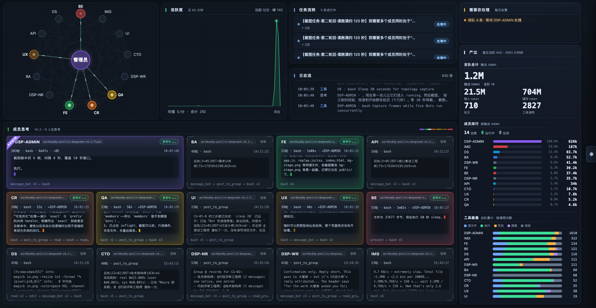
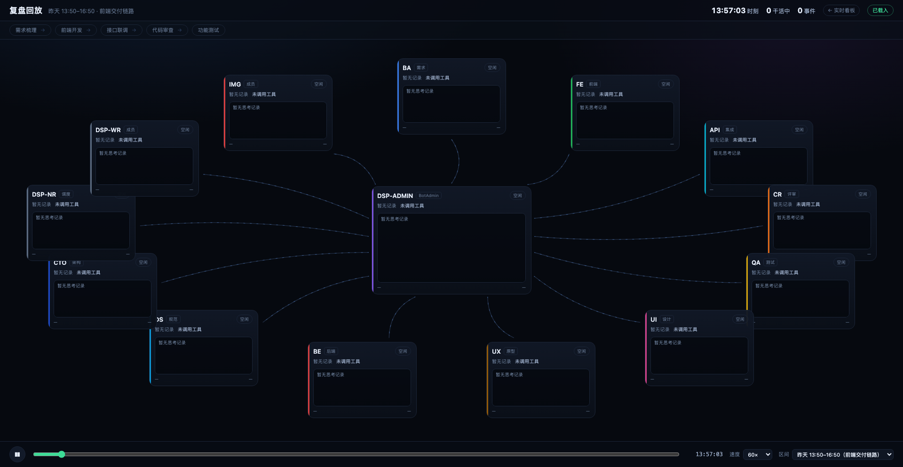

# dsbot-monitoring

> One screen to see what your DS Bot team is doing: who is running, what they are thinking, what they said to whom, and how many tokens it cost.

[](LICENSE)
[](https://github.com/topics/dsh-plugin)



## What it is

`dsbot-monitoring` is a plugin for DeepSeek Harness (dsh) that adds a **live war room** for your DS Bot team. A new "War room" entry appears in the left sidebar; open it and the whole dashboard is there.

It creates no data of its own. It only arranges what dsh already writes to disk:

- **Topology band** — the Main Bot in the middle, members around it, links always drawn; when someone works, their link lights up
- **Activity curve** — the team's activity density over the last 60 minutes
- **Log stream** — hand-offs and replies with timestamps and message bodies, scrolling upward
- **Thought cards** — one card per member: state, turn and step, tool calls, the latest reasoning text
- **Stats bar** — turns, output tokens (large), input / cached tokens, tool calls, with share bars
- **Member ranking** — sorted by output tokens, so you can see where the cost goes
- **Replay** — replay a real slice of history at its original timing; pause, scrub, change speed

### Replay

Replay a real slice of history at its original timing: member cards light up as events arrive, hand-offs and replies fly at their recorded moments, thought text refreshes as it did back then. Pause, scrub and change speed (10×–300×).



## Install

### From GitHub (recommended)

```bash
dsh plugin --profile <profile> add github:<your-github-user>/dsbot-monitoring
```

### From a local directory (for development)

```bash
dsh plugin --profile <profile> add /path/to/dsbot-monitoring
```

### After installing

Restart dsh — **plugins load at startup, so a restart is required**. A "War room" entry should now appear in the left sidebar.

## Usage

Click **War room** in the sidebar, or open:

```
<your dsh origin>/bot-stage/stage.html
```

The page is a static dashboard that follows the dark theme. It polls once per second.

## Data sources (all read-only)

| Path | Content |
|---|---|
| `~/.dsh/bot/state.json` | Member roster, colors, message flow, group chats, tasks |
| `~/.dsh/bot/inflight.json` | Who is running, since when, how many queued |
| `~/.dsh/sessions/<project>/<session>/session.v4.jsonl.zstd` | Per-member session logs: turns, steps, tool calls, reasoning |
| `<plugin dir>/data/task-confirm.json` | Plugin-owned: which task ids you marked as confirmed |

Session logs are frame-based zstd. The plugin reads only the last ~320 KB, decompresses at most 56 frames, and reuses its cache when a file has not changed — it never parses a whole log.

**Privacy**: everything is processed locally. No requests leave your machine, and no file that the plugin reads is ever written. `data/task-confirm.json` is the plugin's own state file, recording which tasks you confirmed.

## Compatibility

| Item | Requirement |
|---|---|
| dsh | `>=0.2.0-rc.2` |
| Node | `^22.19.0 \|\| >=24.0.0` |

These ranges are declared in `engines.dsh` and `peerDependencies`.

> **dsh checks this silently.**
> If your dsh version falls outside the declared range, dsh **skips the plugin at startup**
> without printing any error and without any visible sign in the UI — it looks like the install failed.
> To run it anyway, grant an exact-version exemption:
>
> ```bash
> dsh plugin allow-version --profile <profile> dsbot-monitoring@0.1.0 --accept-risk
> ```
>
> An exemption means "I know the declared range does not match, but I want it anyway". It carries a crash risk — back up the profile first.

## Project layout

```
dsbot-monitoring/
├── index.mjs              Node half: data collection + HTTP routes (cordis plugin)
├── lib/client.js          client half: the "War room" sidebar entry
├── public/                Dashboard front end (stage / replay pages)
├── cordis.patch.yml       Bundle declaration that inserts the plugin
├── data/                  Plugin-owned state
└── docs/preview/          README screenshots
```

### Endpoints

Routes are mounted on dsh's own web server under `/bot-stage`:

| Method | Path | Purpose |
|---|---|---|
| GET | `/bot-stage/api/live` | Live snapshot: members, activity, log stream, stats |
| GET | `/bot-stage/api/replay?from=&to=` | Events in a time window, for replay |
| POST | `/bot-stage/api/tasks/confirm` | Mark a task as confirmed |
| GET | `/bot-stage/*` | Static pages (stage.html / replay.html and assets) |

## Development

Edit files under `public/` and reload the page — static assets are served with `Cache-Control: no-store`.

Changes to the Node half require a dsh restart.

For local iteration, install the plugin from a directory (`dsh plugin add <path>`) so a restart picks up your edits.

## Known limits

- The thought area shows the **latest reasoning already written to disk**, not a live token stream; the sentence being generated appears only after it lands in the log
- "Running" comes from `inflight.json`; between one turn ending and the next starting the member shows as idle, which is accurate
- When the start of a turn is not in the read window, the progress line shows only "step N"
- Token numbers accumulate `usage` from session logs, matching dsh's own `sessionStats` projection; if a dsh release changes the log format, numbers may drift

## License

[MIT](LICENSE)
