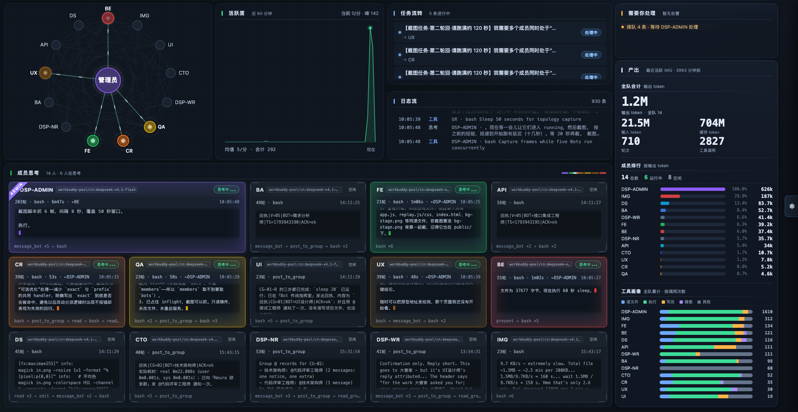
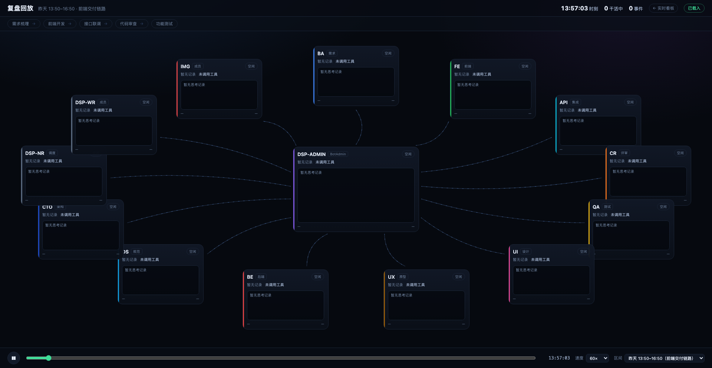

# dsbot-monitoring

> 一屏看见 DS Bot 团队在干什么：谁在跑、在想什么、跟谁说了什么、花了多少 token。

[](LICENSE)
[](https://github.com/topics/dsh-plugin)



## 这是什么

`dsbot-monitoring` 是 DeepSeek Harness（dsh）的一个插件，给你的 DS Bot 团队加一块**实时作战室**：左侧导航多一个「作战室」入口，点开就是整块大屏。

它不产生任何数据，只把 dsh 已经写在本地的东西整理成一屏：

- **拓扑带**——主 Bot 居中、成员环绕，连线常驻；谁在干活，对应链路就亮起来
- **活跃度曲线**——最近 60 分钟的团队活动密度
- **日志流**——带时间戳的派活与回执，含消息正文，自动上滚
- **思考区**——一个成员一张卡：状态、第几轮第几步、调了什么工具、最近一段推理内容
- **统计条**——轮次、输出 token（大字）、输入 / 缓存 token、工具调用次数，带占比条
- **成员排行**——按输出 token 排序，一眼看出谁最费钱
- **复盘回放**——把某段真实历史按原始时刻重放一遍，可暂停、拖进度、调速

### 复盘回放

把某一段真实历史按原始时刻重放：成员卡片随事件逐个亮起、派活与回执按原来的时间点飞出、思考内容按当时的记录刷新。可暂停、拖进度、调速（10×–300×）。



## 安装

### 从 GitHub 安装（推荐）

```bash
dsh plugin --profile <profile 名> add github:<你的 GitHub 用户名>/dsbot-monitoring
```

### 本地目录安装（开发用）

```bash
dsh plugin --profile <profile 名> add /path/to/dsbot-monitoring
```

### 装完确认

重启 dsh（**插件在启动时加载，不重启不生效**），然后看左侧导航：应该多出一项「作战室」。

设置页里也会多一张说明卡。

## 怎么用

点左侧导航的「作战室」，或者直接访问：

```
<你的 dsh 地址>/bot-stage/stage.html
```

页面是纯静态看板，跟着主题走深色底。数据每 1 秒刷新一次。

## 数据来源（全部只读）

| 路径 | 内容 |
|---|---|
| `~/.dsh/bot/state.json` | 成员名单、颜色、消息流水、群聊、任务 |
| `~/.dsh/bot/inflight.json` | 谁正在跑、从何时开始、几条在排队 |
| `~/.dsh/sessions/<项目>/<会话>/session.v4.jsonl.zstd` | 各成员会话日志：轮次、步骤、工具调用、推理内容 |
| `<插件目录>/data/task-confirm.json` | 本插件自有：你点过「已确认」的任务 id |

会话日志是分帧 zstd，插件只读文件尾部约 320 KB、最多解压 56 帧；文件没变就复用缓存，不做全量解析。

**隐私**：所有数据都在本机处理。不外发任何请求，不写任何被读取的文件（`data/task-confirm.json` 是插件自己的状态文件，用于记住你确认过哪些任务）。

## 兼容性

| 项 | 要求 |
|---|---|
| dsh | `>=0.2.0-rc.2` |
| Node | `^22.19.0 \|\| >=24.0.0` |

插件在 `package.json` 的 `engines.dsh` 和 `peerDependencies` 里声明了这些范围。

> **注意 dsh 的版本校验是静默的。**
> 如果你的 dsh 版本不在声明范围内，dsh 启动时会**直接跳过这个插件**，
> 日志里不打印任何错误，界面上也看不出来——你会以为是装错了。
> 确实要用不兼容版本，可以开版本豁免：
>
> ```bash
> dsh plugin allow-version --profile <profile 名> dsbot-monitoring@0.1.0 --accept-risk
> ```
>
> 豁免意味着「我知道声明的范围对不上，但我仍然要用」，有崩溃风险，请先备份 profile。

## 目录结构

```
dsbot-monitoring/
├── index.mjs              Node half：数据采集 + HTTP 路由（cordis 插件）
├── lib/client.js          client half：左侧导航「作战室」入口
├── public/                看板前端（stage / replay 两个页面）
├── cordis.patch.yml       bundle 声明，把插件插进组合
├── data/                  插件自有状态
└── docs/preview/          README 截图
```

### 接口

插件把路由挂在 dsh 的 webServer 上，统一前缀 `/bot-stage`：

| 方法 | 路径 | 说明 |
|---|---|---|
| GET | `/bot-stage/api/live` | 实时快照：成员、活动、日志流、统计 |
| GET | `/bot-stage/api/replay?from=&to=` | 指定时间窗的历史事件，用于回放 |
| POST | `/bot-stage/api/tasks/confirm` | 标记任务已确认 |
| GET | `/bot-stage/*` | 静态页面（stage.html / replay.html 等） |

## 开发

改前端直接编辑 `public/` 下的文件，刷新页面即可（插件对静态资源发 `Cache-Control: no-store`）。

改 Node half 后需要重启 dsh。

本地调试时插件目录建议用 `dsh plugin add <本地路径>` 装，这样改完重启就能看到效果。

## 已知边界

- 思考区显示的是**已经落盘的最近一段推理**，不是逐字直播；正在生成的那句话要等它写进日志才出现
- 「进行中」按 `inflight.json` 判定，一轮结束到下一轮开始之间会短暂显示空闲，这是真实状态
- 读不到轮次开头时，进度行只显示「第 N 步」
- token 统计按会话日志里的 `usage` 累计，和 dsh 官方 `sessionStats` 口径一致；不同版本日志格式若有调整，数值可能对不上

## 许可证

[MIT](LICENSE)
